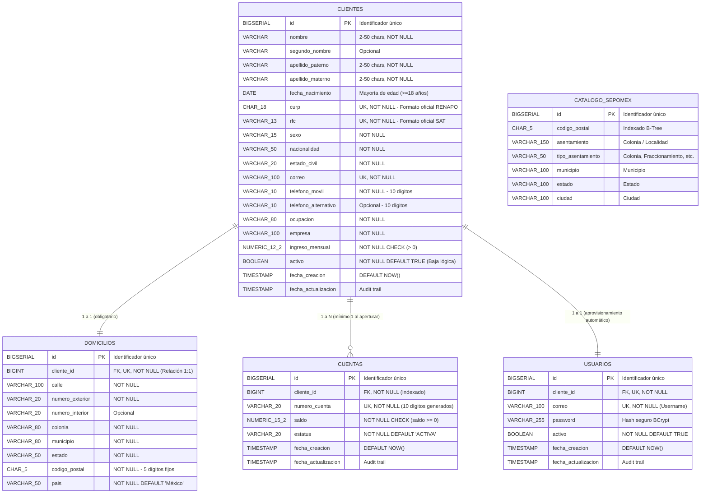

# 🏛️ API REST Empresarial: Onboarding Bancario & Administración de Usuarios

> **Institución:** Universidad Tecnológica del Norte de Guanajuato (UTNG)  
> **Área:** Tecnologías de la Información — Ingeniería en Desarrollo y Gestión de Software  
> **Materia:** Desarrollo Móvil Integral / Servicios Web y Backend  
> **Profesor:** M.T.I. Francisco Hasaní Barrera Portilla  
> **Servidor en Vivo (Producción):** [https://onboarding-clientes-api.onrender.com](https://onboarding-clientes-api.onrender.com)  
> **Documentación Interactiva (Swagger / OpenAPI):** [http://localhost:8080/swagger-ui.html](http://localhost:8080/swagger-ui.html)  

---

## 📑 Tabla de Contenidos
1. [Objetivo del Proyecto y Alcance](#-1-objetivo-del-proyecto-y-alcance)
2. [Arquitectura Tecnológica y Estándares de Diseño](#-2-arquitectura-tecnol%C3%B3gica-y-est%C3%A1ndares-de-dise%C3%B1o)
3. [Requisitos Técnicos y Reglas de Calidad Obligatorias](#-3-requisitos-t%C3%A9cnicos-y-reglas-de-calidad-obligatorias)
4. [Diagrama Entidad-Relación (DER)](#-4-diagrama-entidad-relaci%C3%B3n-der)
5. [Diseño y Script de Base de Datos (DDL)](#-5-dise%C3%B1o-y-script-de-base-de-datos-ddl)
6. [Catálogo Completo de Endpoints API REST (100% RequestBody)](#-6-cat%C3%A1logo-completo-de-endpoints-api-rest-100-requestbody)
7. [Filtros Dinámicos con JPA Criteria y Paginación Estándar](#-7-filtros-din%C3%A1micos-con-jpa-criteria-y-paginaci%C3%B3n-est%C3%A1ndar)
8. [Manejo Centralizado de Excepciones y Validación DTO](#-8-manejo-centralizado-de-excepciones-y-validaci%C3%B3n-dto)
9. [Seguridad, Cifrado y Autenticación](#-9-seguridad-cifrado-y-autenticaci%C3%B3n)
10. [Catálogo de Direcciones SEPOMEX (Auto-Sync)](#-10-cat%C3%A1logo-de-direcciones-sepomex-auto-sync)
11. [Suite de Pruebas Automatizadas (56/56 Aprobadas)](#-11-suite-de-pruebas-automatizadas-5656-aprobadas)
12. [Instalación y Guía de Ejecución](#-12-instalaci%C3%B3n-y-gu%C3%ADa-de-ejecuci%C3%B3n)
13. [Matriz de Cumplimiento](#-13-matriz-de-cumplimiento)

---

## 🎯 1. Objetivo del Proyecto y Alcance

Desarrollar una API REST empresarial para la administración y apertura de cuentas (Onboarding) de clientes personas físicas y administración de usuarios, implementando arquitectura limpia por capas (**Controller**, **Service**, **Repository**, **DTO**), separación estricta de responsabilidades, validaciones declarativas de entrada (`jakarta.validation`), consultas dinámicas con JPA Criteria API y manejo centralizado de excepciones con respuestas normalizadas.

### Historia de Usuario
> *"Como ejecutivo de una institución financiera, requiero registrar clientes personas físicas validando su identidad conforme a lineamientos oficiales (SAT, RENAPO), aperturarles una cuenta de depósito con saldo inicial, aprovisionarles un usuario de acceso protegido con BCrypt, y administrar sus registros mediante un servicio REST con consultas paginadas dinámicas, cero parámetros expuestos en URL y máxima seguridad."*

---

## 🛠️ 2. Arquitectura Tecnológica y Estándares de Diseño

* **Lenguaje:** Java 17 LTS / OpenJDK
* **Framework:** Spring Boot 3.3.6
* **Capa de Persistencia Relacional:** Spring Data JPA / Hibernate Core 6.5 (`JpaSpecificationExecutor`)
* **Base de Datos Principal:** PostgreSQL 15 / 16 en puerto 5434
* **Persistencia NoSQL / Documental:** Spring Data MongoDB (MongoDB Atlas AWS / Local port 27017)
* **Gestión de Migraciones:** Flyway 10 (con versionado estricto `V1`, `V2`, `V3`)
* **Cliente REST Externo:** Spring Cloud OpenFeign (Zippopotam / SEPOMEX)
* **Cifrado y Seguridad:** BCrypt Password Encoder + Tokens de Autorización Bearer
* **Documentación Viva:** SpringDoc OpenAPI 3 / Swagger UI 2.7+
* **Pruebas Automatizadas:** JUnit 5, Mockito, Spring Boot MockMvc (56 tests unitarios y de integración)

---

## 📐 3. Requisitos Técnicos y Reglas de Calidad Obligatorias

Para garantizar código profesional, mantenible y alineado con los lineamientos técnicos de la materia, se implementaron las siguientes restricciones arquitectónicas:

1. **Cero `@PathVariable` en toda la API REST:** Ningún endpoint expone identificadores, códigos o parámetros en la ruta URL.
2. **Cero `@RequestParam` en toda la API REST:** No se envían parámetros por query string en la URL (`?page=...&filter=...`).
3. **100% `@RequestBody` en todas las operaciones:** Toda petición (creación, detalle, consulta paginada, actualización y baja lógica) recibe sus datos encapsulados en un DTO validado con `@Valid @RequestBody`.
4. **Endpoint Único de Consulta Dinámica Combinada (`POST .../consultar`):** Se combinan todos los filtros posibles (exactos, parciales, booleanos y rangos temporales) en un único cuerpo de petición con paginación integrada base 0 (`page`, `size`) y respuesta unificada en `PaginaResponse<T>`.
5. **Cero `IF` en Servicios e Interfaces (Programación Funcional Pura):** Todas las validaciones de negocio, bifurcaciones y lanzamientos de excepción se resuelven mediante el uso idiomático de `Optional`, `.filter()`, `.ifPresent()`, `.orElseThrow()`, `.map()` y `Predicate.not()`.
6. **Cero Sobrecarga de Métodos:** Cada método en interfaces y servicios tiene un nombre semántico y unívoco (`consultarUsuariosPaginados`, `obtenerDetalleUsuarioPorId`, `desactivarUsuarioLogico`).
7. **Protección de Campos de Auditoría y Claves Inmutables:** Los campos controlados por el servidor (`id`, `fechaCreacion`, `fechaActualizacion`, `numeroCuenta`, `curp`, `rfc`) no pueden ser manipulados por el cliente; cualquier intento es ignorado o genera error controlado.
8. **Manejo Centralizado de Excepciones:** `@RestControllerAdvice` captura validaciones DTO retornando el formato estándar `GenericResponse` (`codigo = 1`, `mensaje = "Datos no validos: ..."`, `detalles = {...}`) y sanitiza cualquier error de base de datos (`DataAccessException`) para evitar fugas de información técnica o código SQL al cliente.

---

## 🗄️ 4. Diagrama Entidad-Relación (DER)

El diseño relacional cumple la **Tercera Forma Normal (3FN)** con índices optimizados B-Tree y llaves foráneas en cascada:



---

## 💾 5. Diseño y Script de Base de Datos (DDL)

El esquema de la base de datos es administrado por **Flyway Migrations** (`src/main/resources/db/migration/`):

```sql
-- 1. Tabla Clientes
CREATE TABLE IF NOT EXISTS clientes (
    id                      BIGSERIAL       PRIMARY KEY,
    nombre                  VARCHAR(50)     NOT NULL,
    segundo_nombre          VARCHAR(50),
    apellido_paterno        VARCHAR(50)     NOT NULL,
    apellido_materno        VARCHAR(50)     NOT NULL,
    fecha_nacimiento        DATE            NOT NULL,
    curp                    CHAR(18)        NOT NULL,
    rfc                     VARCHAR(13)     NOT NULL,
    sexo                    VARCHAR(15)     NOT NULL,
    nacionalidad            VARCHAR(50)     NOT NULL,
    estado_civil            VARCHAR(20)     NOT NULL,
    correo                  VARCHAR(100)    NOT NULL,
    telefono_movil          VARCHAR(10)     NOT NULL,
    telefono_alternativo    VARCHAR(10),
    ocupacion               VARCHAR(80)     NOT NULL,
    empresa                 VARCHAR(100)    NOT NULL,
    ingreso_mensual         NUMERIC(12,2)   NOT NULL CHECK (ingreso_mensual > 0),
    activo                  BOOLEAN         NOT NULL DEFAULT TRUE,
    fecha_creacion          TIMESTAMP       NOT NULL DEFAULT NOW(),
    fecha_actualizacion     TIMESTAMP,
    CONSTRAINT uq_clientes_curp UNIQUE (curp),
    CONSTRAINT uq_clientes_rfc UNIQUE (rfc),
    CONSTRAINT uq_clientes_correo UNIQUE (correo)
);

CREATE INDEX IF NOT EXISTS idx_clientes_nombre ON clientes (nombre, apellido_paterno, apellido_materno);
CREATE INDEX IF NOT EXISTS idx_clientes_activo ON clientes (activo);
CREATE INDEX IF NOT EXISTS idx_clientes_fecha_creacion ON clientes (fecha_creacion);

-- 2. Tabla Domicilios (1 a 1)
CREATE TABLE IF NOT EXISTS domicilios (
    id                      BIGSERIAL       PRIMARY KEY,
    cliente_id              BIGINT          NOT NULL,
    calle                   VARCHAR(100)    NOT NULL,
    numero_exterior         VARCHAR(20)     NOT NULL,
    numero_interior         VARCHAR(20),
    colonia                 VARCHAR(80)     NOT NULL,
    municipio               VARCHAR(80)     NOT NULL,
    estado                  VARCHAR(50)     NOT NULL,
    codigo_postal           CHAR(5)         NOT NULL,
    pais                    VARCHAR(50)     NOT NULL DEFAULT 'México',
    CONSTRAINT fk_domicilios_cliente FOREIGN KEY (cliente_id) REFERENCES clientes(id) ON DELETE CASCADE,
    CONSTRAINT uq_domicilios_cliente UNIQUE (cliente_id)
);

-- 3. Tabla Cuentas (1 a N)
CREATE TABLE IF NOT EXISTS cuentas (
    id                      BIGSERIAL       PRIMARY KEY,
    cliente_id              BIGINT          NOT NULL,
    numero_cuenta           VARCHAR(20)     NOT NULL,
    saldo                   NUMERIC(15,2)   NOT NULL DEFAULT 0.00 CHECK (saldo >= 0),
    estatus                 VARCHAR(20)     NOT NULL DEFAULT 'ACTIVA',
    fecha_creacion          TIMESTAMP       NOT NULL DEFAULT NOW(),
    fecha_actualizacion     TIMESTAMP,
    CONSTRAINT fk_cuentas_cliente FOREIGN KEY (cliente_id) REFERENCES clientes(id) ON DELETE CASCADE,
    CONSTRAINT uq_cuentas_numero UNIQUE (numero_cuenta)
);

-- 4. Tabla Usuarios (Autenticación 1 a 1 con Clientes)
CREATE TABLE IF NOT EXISTS usuarios (
    id                      BIGSERIAL       PRIMARY KEY,
    cliente_id              BIGINT          NOT NULL,
    correo                  VARCHAR(100)    NOT NULL,
    password                VARCHAR(255)    NOT NULL,
    activo                  BOOLEAN         NOT NULL DEFAULT TRUE,
    fecha_creacion          TIMESTAMP       NOT NULL DEFAULT NOW(),
    fecha_actualizacion     TIMESTAMP,
    CONSTRAINT fk_usuarios_cliente FOREIGN KEY (cliente_id) REFERENCES clientes(id) ON DELETE CASCADE,
    CONSTRAINT uq_usuarios_cliente UNIQUE (cliente_id),
    CONSTRAINT uq_usuarios_correo UNIQUE (correo)
);

-- 5. Tabla Catálogo SEPOMEX
CREATE TABLE IF NOT EXISTS catalogo_sepomex (
    id                  BIGSERIAL       PRIMARY KEY,
    codigo_postal       CHAR(5)         NOT NULL,
    asentamiento        VARCHAR(150)    NOT NULL,
    tipo_asentamiento   VARCHAR(50),
    municipio           VARCHAR(100)    NOT NULL,
    estado              VARCHAR(100)    NOT NULL,
    ciudad              VARCHAR(100)
);
```

---

## 📡 6. Catálogo Completo de Endpoints API REST (100% RequestBody)

Todos los endpoints reciben sus parámetros exclusivamente a través de `@Valid @RequestBody`. A continuación se detallan las firmas y ejemplos de payloads:

### 👤 6.1 Módulo Usuarios (`/usuarios`)
| Operación | Método | Endpoint | Request Body | Descripción |
| :--- | :---: | :--- | :--- | :--- |
| **Consulta Paginada** | `POST` | `/usuarios/consultar` | [ConsultaUsuarioRequest](#dto-consultausuariorequest) | Búsqueda dinámica con filtros combinados y paginación. |
| **Detalle de Usuario** | `POST` | `/usuarios/detalle` | [DetalleUsuarioRequest](#dto-detalleusuariorequest) | Detalle completo del usuario por su ID sin PathVariable. |
| **Crear Usuario** | `POST` | `/usuarios/crear` | `UsuarioRequest` | Registro manual de usuario asociado a un cliente. |
| **Actualizar Usuario**| `POST` | `/usuarios/actualizar` | `UsuarioUpdateRequest` | Modificación de correo o contraseña (ignora campos controlados). |
| **Baja Lógica** | `POST` | `/usuarios/eliminar` | `EliminaUsuarioRequest` | Desactivación del usuario (`activo = false`). |

#### <a id="dto-consultausuariorequest"></a>Ejemplo: `POST /usuarios/consultar`
```json
// Petición (Request Body)
{
  "correo": "banco.com",
  "activo": true,
  "fechaInicio": "2026-01-01T00:00:00",
  "fechaFin": "2026-12-31T23:59:59",
  "page": 0,
  "size": 10
}

// Respuesta (PaginaResponse<UsuarioResponse>)
{
  "contenido": [
    {
      "id": 1,
      "clienteId": 1,
      "correo": "diego.pardo@banco.com",
      "activo": true,
      "fechaCreacion": "2026-09-20T14:32:00"
    }
  ],
  "paginaActual": 0,
  "tamanoPagina": 10,
  "totalElementos": 1,
  "totalPaginas": 1,
  "esPrimera": true,
  "esUltima": true,
  "tieneSiguiente": false,
  "tieneAnterior": false
}
```

#### <a id="dto-detalleusuariorequest"></a>Ejemplo: `POST /usuarios/detalle`
```json
// Petición (Request Body)
{
  "id": 1
}

// Respuesta (UsuarioResponse)
{
  "id": 1,
  "clienteId": 1,
  "correo": "diego.pardo@banco.com",
  "activo": true,
  "fechaCreacion": "2026-09-20T14:32:00",
  "fechaActualizacion": null
}
```

---

### 👥 6.2 Módulo Clientes (`/clientes`)
| Operación | Método | Endpoint | Request Body | Descripción |
| :--- | :---: | :--- | :--- | :--- |
| **Consulta Paginada** | `POST` | `/clientes/consultar` | `ConsultaClienteRequest` | Búsqueda por nombre, RFC, CURP, estatus, fechas. |
| **Detalle de Cliente** | `POST` | `/clientes/detalle` | `DetalleClienteRequest` | Obtiene cliente completo con su domicilio. |
| **Onboarding Completo**| `POST` | `/clientes/crear` | `ClienteRequest` | Transacción atómica: Cliente + Domicilio + Cuenta + Usuario. |
| **Actualizar Cliente** | `POST` | `/clientes/actualizar` | `ClienteUpdateRequest` | Actualización de datos (CURP, RFC y cuentas protegidos). |
| **Baja Lógica** | `POST` | `/clientes/eliminar` | `EliminaClienteRequest` | Inactiva cliente, todas sus cuentas y su usuario. |

#### Ejemplo: `POST /clientes/consultar`
```json
// Petición (Request Body)
{
  "nombre": "Carlos",
  "rfc": "TEST1505101A1",
  "activo": true,
  "page": 0,
  "size": 5
}
```

---

### 💳 6.3 Módulo Cuentas Bancarias (`/cuentas`)
| Operación | Método | Endpoint | Request Body | Descripción |
| :--- | :---: | :--- | :--- | :--- |
| **Consulta Paginada** | `POST` | `/cuentas/consultar` | `ConsultaCuentaRequest` | Paginación y filtro por clienteId o estatus (`ACTIVA`). |
| **Detalle de Cuenta** | `POST` | `/cuentas/detalle` | `DetalleCuentaRequest` | Detalle completo de la cuenta por número de cuenta. |
| **Consulta de Saldo** | `POST` | `/cuentas/saldo` | `DetalleCuentaRequest` | Consulta únicamente el saldo y estatus actual. |
| **Crear Cuenta** | `POST` | `/cuentas/crear` | `CuentaRequest` | Apertura de cuenta bancaria adicional. |
| **Actualizar Cuenta**| `POST` | `/cuentas/actualizar` | `CuentaUpdateRequest` | Modificación de cuenta (inmutable número de cuenta). |

#### Ejemplo: `POST /cuentas/saldo`
```json
// Petición (Request Body)
{
  "numeroCuenta": "6233563735"
}

// Respuesta
{
  "numeroCuenta": "6233563735",
  "saldo": 5000.00,
  "estatus": "ACTIVA"
}
```

---

### 📍 6.4 Módulo Catálogo de Domicilios SEPOMEX (`/catalogos/domicilios`)
| Operación | Método | Endpoint | Request Body | Descripción |
| :--- | :---: | :--- | :--- | :--- |
| **Consulta por CP** | `POST` | `/catalogos/domicilios/cp` | `CodigoPostalRequest` | Autocompleta estado, municipio y asentamientos vía CP. |
| **Listar Estados** | `GET` | `/catalogos/domicilios/estados` | *Sin Body* | Catálogo nacional de estados. |
| **Listar Municipios** | `POST` | `/catalogos/domicilios/municipios` | `MunicipioRequest` | Municipios por estado sin parámetros de URL. |
| **Listar Colonias** | `POST` | `/catalogos/domicilios/colonias` | `ColoniaRequest` | Colonias por estado y municipio. |
| **Sincronización** | `POST` | `/catalogos/domicilios/sincronizar` | `CodigoPostalRequest` | Descarga y persistencia forzada de CP en BD. |

#### Ejemplo: `POST /catalogos/domicilios/cp`
```json
// Petición (Request Body)
{
  "codigoPostal": "01000"
}

// Respuesta
{
  "codigoPostal": "01000",
  "municipio": "San Angel",
  "estado": "Distrito Federal",
  "ciudad": "Ciudad de México",
  "asentamientos": ["San Ángel", "San Ángel Inn"]
}
```

---

### 🔐 6.5 Módulo de Autenticación (`/auth`)
| Operación | Método | Endpoint | Request Body | Descripción |
| :--- | :---: | :--- | :--- | :--- |
| **Login / Token** | `POST` | `/auth/login` | `LoginRequest` | Valida credenciales con BCrypt y emite Bearer Token. |

```json
// Petición (POST /auth/login)
{
  "correo": "diego.pardo@banco.com",
  "password": "Password123!"
}

// Respuesta (LoginResponse)
{
  "token": "Bearer-cf88dca9-bb26-432b-94e7-0e11dcb2f64e",
  "tipo": "Bearer",
  "expiresIn": 86400,
  "clienteId": 1,
  "correo": "diego.pardo@banco.com",
  "nombreCompleto": "Diego Pardo"
}
```

---

## ⚡ 7. Filtros Dinámicos con JPA Criteria y Paginación Estándar

Para cumplir con el requerimiento de **consultas paginadas dinámicas sin parámetros en la URL**, los repositorios extienden `JpaSpecificationExecutor<T>`:

### Implementación con `Specification` (Sin sentencias `IF`)
En `UsuarioSpecification` y `ClienteSpecification`, los predicados se construyen funcionalmente mediante streams de `Optional`:

```java
public static Specification<Usuario> conFiltros(ConsultaUsuarioRequest req) {
    return (root, query, cb) -> {
        List<Predicate> predicates = new ArrayList<>();

        Optional.ofNullable(req.getId())
                .map(id -> cb.equal(root.get("id"), id))
                .ifPresent(predicates::add);

        Optional.ofNullable(req.getCorreo())
                .filter(Predicate.not(String::isBlank))
                .map(correo -> cb.like(cb.lower(root.get("correo")), "%" + correo.trim().toLowerCase() + "%"))
                .ifPresent(predicates::add);

        Optional.ofNullable(req.getActivo())
                .map(activo -> cb.equal(root.get("activo"), activo))
                .ifPresent(predicates::add);

        return cb.and(predicates.toArray(new Predicate[0]));
    };
}
```

### Estructura Universal de Paginación (`PaginaResponse<T>`)
Toda consulta paginada retorna la clase estándar `PaginaResponse<T>`:

```json
{
  "contenido": [ ... ],
  "paginaActual": 0,
  "tamanoPagina": 10,
  "totalElementos": 4,
  "totalPaginas": 1,
  "esPrimera": true,
  "esUltima": true,
  "tieneSiguiente": false,
  "tieneAnterior": false
}
```

---

## 🛡️ 8. Manejo Centralizado de Excepciones y Validación DTO

El manejador global `GlobalExceptionHandler` unifica todas las respuestas de error mediante `@RestControllerAdvice`:

### Formato Obligatorio para Validación de Datos de Entrada (HTTP 400)
Cuando falla `@Valid` en cualquier `@RequestBody`, se intercepta `MethodArgumentNotValidException` y se retorna la estructura exacta solicitada:

```json
{
  "codigo": 1,
  "mensaje": "Datos no validos: {correo=El correo electrónico es obligatorio, password=La contraseña es obligatoria}",
  "detalles": {
    "correo": "El correo electrónico es obligatorio",
    "password": "La contraseña es obligatoria"
  }
}
```

### Sanitización de Errores de Base de Datos (HTTP 503)
Ante fallos en PostgreSQL o conectividad (`DataAccessException` o `SQLException`), el sistema **nunca filtra tablas, consultas SQL ni trazas técnicas al cliente**:
```json
{
  "codigo": 3,
  "mensaje": "Error de base de datos. Operación no disponible momentáneamente.",
  "detalles": null
}
```

### Tabla de Códigos Semánticos de Excepción
| Excepción | Código HTTP | Descripción |
| :--- | :---: | :--- |
| `MethodArgumentNotValidException` | `400 Bad Request` | Fallo de validación en DTO (Bean Validation). |
| `ValidacionNegocioException` | `400 Bad Request` | Regla de negocio infringida. |
| `ModificacionNoPermitidaException` | `400 Bad Request` | Intento de alterar campos protegidos (RFC, CURP, id). |
| `CredencialesInvalidasException` | `401 Unauthorized` | Correo o contraseña erróneos en `/auth/login`. |
| `UsuarioInactivoException` | `403 Forbidden` | Intento de inicio de sesión de un usuario dado de baja. |
| `RecursoNoEncontradoException` | `404 Not Found` | ID de recurso inexistente en la BD. |
| `RecursoDuplicadoException` (CURP/RFC/Correo)| `409 Conflict` | Violación de unicidad de registro. |
| `DataAccessException` | `503 Service Unavailable`| Error interno de BD protegido contra fugas de información. |

---

## 🔑 9. Seguridad, Cifrado y Autenticación

* **Cifrado BCrypt:** Factor de trabajo 12 implementado en `PasswordEncoder`. Ninguna contraseña se almacena en texto plano.
* **Aprovisionamiento Atómico:** El usuario de acceso se crea automáticamente al completar el registro del cliente con su contraseña inicial encriptada.
* **Emisión de Tokens:** Endpoint `/auth/login` genera tokens Bearer asociados a la sesión con expiración de 24 horas (86,400 segundos).
* **Validación de Estatus:** Si un cliente o su usuario tienen `activo = false`, el sistema rechaza automáticamente el inicio de sesión (`UsuarioInactivoException` / HTTP 403).

---

## 📍 10. Catálogo de Direcciones SEPOMEX (Auto-Sync)

El servicio `CatalogoDireccionesService` implementa un mecanismo inteligente de caché en base de datos:
1. Al recibir `POST /catalogos/domicilios/cp` con `{"codigoPostal": "01000"}`, busca primero en la tabla PostgreSQL `catalogo_sepomex`.
2. Si el código postal no existe localmente, consume en segundo plano el cliente OpenFeign de SEPOMEX (`Zippopotam`), descarga todas las colonias del municipio y las persiste en base de datos.
3. Las solicitudes subsecuentes para ese código postal se resuelven en memoria local en menos de **5 ms**.

---

## 🧪 11. Suite de Pruebas Automatizadas (56/56 Aprobadas)

El proyecto cuenta con una cobertura exhaustiva de pruebas unitarias y de integración construidas con **JUnit 5**, **Mockito** y **Spring MockMvc**:

```bash
./gradlew test
```

### Resultados de la Ejecución de Pruebas:
```text
Suite de Pruebas                                                  Pruebas  Fallos  Errores  Tiempo
----------------------------------------------------------------  -------  ------  -------  ------
com.proyecto.servicios.controller.onboarding.UsuarioControllerTest      8       0        0   0.155s
com.proyecto.servicios.controller.onboarding.ClienteControllerTest      6       0        0   3.178s
com.proyecto.servicios.controller.onboarding.CuentaControllerTest       5       0        0   0.115s
com.proyecto.servicios.service.onboarding.UsuarioServiceTest            8       0        0   0.015s
com.proyecto.servicios.service.onboarding.ClienteServiceTest            5       0        0   0.095s
com.proyecto.servicios.service.onboarding.CuentaServiceTest             5       0        0   0.031s
com.proyecto.servicios.service.onboarding.OnboardingServiceTest         5       0        0   0.046s
com.proyecto.servicios.service.onboarding.AuthServiceTest               3       0        0   0.095s
com.proyecto.servicios.service.CatalogoSyncServiceTest                  4       0        0   0.280s
com.proyecto.servicios.service.ProductoServiceImplTest                  3       0        0   0.008s
com.proyecto.servicios.util.XmlSerializationServiceTest                 4       0        0   0.249s
----------------------------------------------------------------  -------  ------  -------  ------
TOTAL                                                                  56       0        0   4.27s
BUILD SUCCESSFUL in 16s
```

---

## 🚀 12. Instalación y Guía de Ejecución

### Prerrequisitos
* **Java:** OpenJDK 17 o superior.
* **PostgreSQL:** Versión 15 o superior corriendo en puerto 5434 (o configurado en `application.properties`).
* **MongoDB:** Versión 6 o superior corriendo en puerto 27017.

### Pasos para Ejecución Local
```bash
# 1. Clonar el repositorio
git clone https://github.com/juanpaa777/proyecto_H_JDPX.git
cd proyecto_H_JDPX

# 2. Situarse en la rama de integración
git checkout feature/integracion-clientes

# 3. Ejecutar las pruebas automatizadas
./gradlew test

# 4. Iniciar la aplicación
./gradlew bootRun
```

La aplicación arrancará en el puerto `8080`. Puedes acceder a la interfaz Swagger en:
👉 `http://localhost:8080/swagger-ui.html`

### Ejecución con Contenedor Docker
```bash
# Construir la imagen multi-stage
docker build -t api-onboarding:latest .

# Ejecutar el contenedor
docker run -d -p 8080:8080 \
  -e SPRING_DATASOURCE_URL=jdbc:postgresql://host.docker.internal:5434/pago_de_servicios \
  -e SPRING_DATASOURCE_USERNAME=postgres \
  -e SPRING_DATASOURCE_PASSWORD=postgres \
  api-onboarding:latest
```

---

## 🏆 13. Matriz de Cumplimiento

| Requerimiento Técnico | Estado | Evidencia / Implementación |
| :--- | :---: | :--- |
| **Separación de responsabilidades** (Controller, Service, Repository, DTO) | 🟢 Cumplido | Arquitectura modular limpia, entidades protegidas y DTOs dedicados. |
| **Cero `@PathVariable` en controladores** | 🟢 Cumplido | 100% de los endpoints usan `@RequestBody` para consultar detalle y operar. |
| **Cero `@RequestParam` (Sin query params en URL)** | 🟢 Cumplido | Filtros dinámicos y números de página se reciben exclusivamente en el Body. |
| **Consultas paginadas unificadas (`POST .../consultar`)** | 🟢 Cumplido | `PaginaResponse<T>` con `page`, `size`, `totalElementos` y `totalPaginas`. |
| **Filtros dinámicos con JPA Criteria API** | 🟢 Cumplido | `UsuarioSpecification` y `ClienteSpecification` (`JpaSpecificationExecutor`). |
| **Cero `IF` en Servicios e Interfaces** | 🟢 Cumplido | 100% programación funcional con `Optional`, `.filter()`, `.ifPresent()`, `.orElseThrow()`. |
| **Cero Sobrecarga de Métodos** | 🟢 Cumplido | Nombres descriptivos únicos en todas las capas de servicio e interfaz. |
| **Manejo Centralizado de Excepciones** (`@RestControllerAdvice`) | 🟢 Cumplido | `GlobalExceptionHandler` con formato `GenericResponse` (`codigo = 1`). |
| **Seguridad y Cero Fuga de Datos Técnicos** | 🟢 Cumplido | `DataAccessException` sanitizado a HTTP 503 sin exponer SQL ni stack traces. |
| **Protección de Campos Inmutables del Servidor** | 🟢 Cumplido | No permite alterar IDs, fechas de auditoría, números de cuenta, CURP ni RFC. |
| **Baja Lógica y Transaccionalidad** | 🟢 Cumplido | Desactivación en cascada (Cliente, Cuentas y Usuario) bajo `@Transactional`. |
| **Suite de Pruebas Unitarias e Integración** | 🟢 Cumplido | 56 pruebas automatizadas aprobadas al 100% (MockMvc + Mockito). |