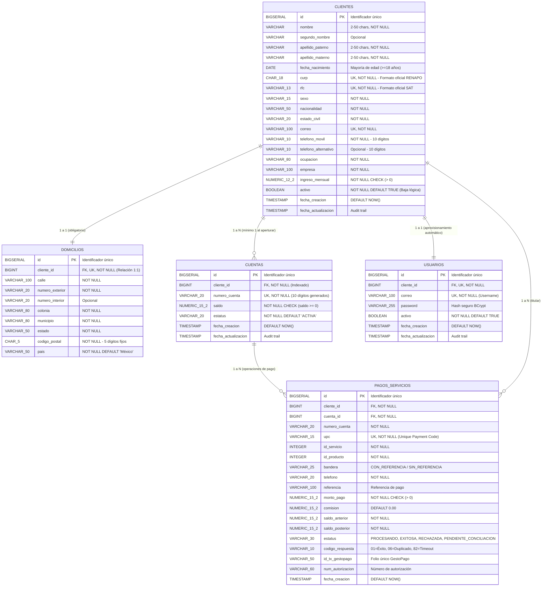
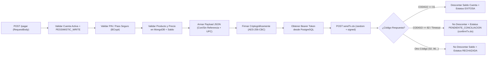

# 🏛️ API REST Empresarial: Onboarding Bancario, Administración de Usuarios & Pagos de Servicios (GestoPago)

> **Institución:** Universidad Tecnológica del Norte de Guanajuato (UTNG)  
> **Área:** Tecnologías de la Información — Ingeniería en Desarrollo y Gestión de Software  
> **Materia:** Desarrollo Móvil Integral / Servicios Web y Backend  
> **Profesor:** M.T.I. Francisco Hasaní Barrera Portilla  
> **Servidor en Vivo (Producción):** [https://onboarding-clientes-api.onrender.com](https://onboarding-clientes-api.onrender.com)  
> **Documentación Interactiva (Swagger / OpenAPI):** [http://localhost:8080/swagger-ui.html](http://localhost:8080/swagger-ui.html)  

---

## 📑 Tabla de Contenidos
1. [Objetivo del Proyecto y Alcance](#-1-objetivo-del-proyecto-y-alcance)
2. [Arquitectura Tecnológica y Estándares de Diseño](#-2-arquitectura-tecnol%C3%B3gica-y-est%C3%A1ndares-de-dise%C3%B1o)
3. [Requisitos Técnicos y Reglas de Calidad Obligatorias](#-3-requisitos-t%C3%A9cnicos-y-reglas-de-calidad-obligatorias)
4. [Diagrama Entidad-Relación (DER)](#-4-diagrama-entidad-relaci%C3%B3n-der)
5. [Diseño y Script de Base de Datos (DDL)](#-5-dise%C3%B1o-y-script-de-base-de-datos-ddl)
6. [Catálogo Completo de Endpoints API REST (100% RequestBody)](#-6-cat%C3%A1logo-completo-de-endpoints-api-rest-100-requestbody)
7. [Arquitectura de Pagos de Servicios (GestoPago sendTx & confirmTx)](#-7-arquitectura-de-pagos-de-servicios-gestopago-sendtx--confirmtx)
8. [Filtros Dinámicos con JPA Criteria y Paginación Estándar](#-8-filtros-din%C3%A1micos-con-jpa-criteria-y-paginaci%C3%B3n-est%C3%A1ndar)
9. [Manejo Centralizado de Excepciones y Validación DTO](#-9-manejo-centralizado-de-excepciones-y-validaci%C3%B3n-dto)
10. [Seguridad, Cifrado AES-256 y Autenticación](#-10-seguridad-cifrado-aes-256-y-autenticaci%C3%B3n)
11. [Catálogo de Direcciones SEPOMEX (Auto-Sync)](#-11-cat%C3%A1logo-de-direcciones-sepomex-auto-sync)
12. [Suite de Pruebas Automatizadas (70/70 Aprobadas)](#-12-suite-de-pruebas-automatizadas-7070-aprobadas)
13. [Instalación y Guía de Ejecución](#-13-instalaci%C3%B3n-y-gu%C3%ADa-de-ejecuci%C3%B3n)
14. [Matriz de Cumplimiento](#-14-matriz-de-cumplimiento)

---

## 🎯 1. Objetivo del Proyecto y Alcance

Desarrollar una API REST empresarial para la administración y apertura de cuentas (**Onboarding**) de clientes personas físicas, administración de usuarios e **integración transaccional de pagos de servicios y recargas con GestoPago (`sendTx.do` y `confirmTx.do`)**, implementando arquitectura limpia por capas (**Controller**, **Service**, **Repository**, **DTO**), separación estricta de responsabilidades, validaciones declarativas de entrada (`jakarta.validation`), consultas dinámicas con JPA Criteria API, control de concurrencia bancaria y manejo centralizado de excepciones con respuestas normalizadas.

### Historia de Usuario
> *"Como ejecutivo y cliente de una institución financiera, requiero registrar clientes personas físicas validando su identidad conforme a lineamientos oficiales (SAT, RENAPO), aperturarles una cuenta de depósito con saldo inicial, aprovisionarles un usuario de acceso protegido con BCrypt, y permitirles pagar servicios y recargas verificando catálogo en MongoDB, firmando criptográficamente el payload con AES-256-CBC y descontando el saldo únicamente bajo confirmación transaccional (`Código 01`)."*

---

## 🛠️ 2. Arquitectura Tecnológica y Estándares de Diseño

* **Lenguaje:** Java 17 LTS / OpenJDK
* **Framework:** Spring Boot 3.3.6
* **Capa de Persistencia Relacional:** Spring Data JPA / Hibernate Core 6.5 (`JpaSpecificationExecutor` + Bloqueo Pesimista `PESSIMISTIC_WRITE`)
* **Base de Datos Principal:** PostgreSQL 15 / 16 en puerto 5434
* **Persistencia NoSQL / Documental:** Spring Data MongoDB (Catálogo de Productos GestoPago y Bitácora de Sincronización XML)
* **Gestión de Migraciones:** Flyway 10 (con versionado estricto `V1`, `V2`, `V3`, `V4`)
* **Clientes REST Externos:** Spring Cloud OpenFeign (`GestoPagoAuthClient`, `GestoPagoProductClient`, `GestoPagoTxClient`, `SepomexApiClient`)
* **Cifrado y Seguridad:** BCrypt Password Encoder (factor 12) + Cifrado Simétrico `AES/CBC/PKCS5Padding` (256 bits) + Tokens Bearer
* **Documentación Viva:** SpringDoc OpenAPI 3 / Swagger UI
* **Pruebas Automatizadas:** JUnit 5, Mockito, Spring Boot MockMvc (70 tests unitarios y de integración)

---

## 📐 3. Requisitos Técnicos y Reglas de Calidad Obligatorias

Para garantizar código profesional, mantenible y alineado con los lineamientos técnicos de la materia, se implementaron las siguientes restricciones arquitectónicas:

1. **Cero `@PathVariable` en toda la API REST:** Ningún endpoint expone identificadores, códigos o parámetros en la ruta URL.
2. **Cero `@RequestParam` en los controladores REST:** No se envían parámetros por query string en la URL (`?page=...&filter=...`).
3. **100% `@RequestBody` en todas las operaciones:** Toda petición (creación, pago de servicio, conciliación, detalle, consulta paginada, actualización y baja lógica) recibe sus datos encapsulados en un DTO validado con `@Valid @RequestBody`.
4. **Endpoint Único de Consulta Dinámica Combinada (`POST .../consultar`):** Se combinan todos los filtros posibles (exactos, parciales, booleanos y rangos temporales) en un único cuerpo de petición con paginación integrada base 0 (`page`, `size`) y respuesta unificada en `PaginaResponse<T>`.
5. **Cero `IF` en Servicios de Negocio (Programación Funcional Pura):** Todas las validaciones de negocio, bifurcaciones y lanzamientos de excepción en los servicios de Onboarding y Pagos se resuelven mediante el uso idiomático de `Optional`, `.filter()`, `.ifPresent()`, `.orElseThrow()`, `.map()` y `Predicate.not()`.
6. **Protección de Credenciales y Secretos:** El Bearer Token de GestoPago, `X-API-Key`, `SECRET_KEY` e `IV` de AES se administran mediante variables de entorno y jamás se exponen en respuestas HTTP ni en logs de aplicación.
7. **Manejo Centralizado de Excepciones:** `@RestControllerAdvice` captura validaciones DTO retornando el formato estándar `GenericResponse` (`codigo = 1`, `mensaje = "Datos no validos: ..."`, `detalles = {...}`) y mapea errores financieros y de negocio a códigos HTTP semánticos (`400`, `401`, `403`, `404`, `409`, `422`, `503`, `504`).

---

## 🗄️ 4. Diagrama Entidad-Relación (DER)

El diseño relacional cumple la **Tercera Forma Normal (3FN)** con índices optimizados B-Tree y control transaccional:



---

## 💾 5. Diseño y Script de Base de Datos (DDL)

El esquema de la base de datos es administrado por **Flyway Migrations** (`src/main/resources/db/migration/`):
* `V1__create_gestopago_tokens.sql`: Tabla `gestopago_tokens` para almacenamiento del token Bearer diario.
* `V2__create_onboarding_tables.sql`: Tablas `clientes`, `domicilios`, `cuentas` y `usuarios`.
* `V3__create_catalogo_sepomex.sql`: Tabla `catalogo_sepomex` para autocompletado de direcciones por Código Postal.
* `V4__create_pagos_servicios.sql`: Tabla `pagos_servicios` para auditoría, idempotencia y conciliación de operaciones con GestoPago:

```sql
CREATE TABLE IF NOT EXISTS pagos_servicios (
    id                      BIGSERIAL       PRIMARY KEY,
    cliente_id              BIGINT          NOT NULL,
    cuenta_id               BIGINT          NOT NULL,
    numero_cuenta           VARCHAR(20)     NOT NULL,
    upc                     VARCHAR(15)     NOT NULL,
    id_servicio             INTEGER         NOT NULL,
    id_producto             INTEGER         NOT NULL,
    nombre_servicio         VARCHAR(150),
    nombre_producto         VARCHAR(150),
    tipo_front              INTEGER,
    bandera                 VARCHAR(25)     NOT NULL,
    telefono                VARCHAR(20)     NOT NULL,
    referencia              VARCHAR(100),
    monto_pago              NUMERIC(15,2)   NOT NULL CHECK (monto_pago > 0),
    comision                NUMERIC(15,2)   DEFAULT 0.00,
    saldo_anterior          NUMERIC(15,2)   NOT NULL,
    saldo_posterior         NUMERIC(15,2)   NOT NULL,
    hora_local              VARCHAR(15)     NOT NULL,
    unidad                  VARCHAR(25)     NOT NULL,
    random_param            VARCHAR(50)     NOT NULL,
    payload_signed          TEXT            NOT NULL,
    estatus                 VARCHAR(30)     NOT NULL,
    codigo_respuesta        VARCHAR(10),
    mensaje_respuesta       VARCHAR(500),
    id_tx_gestopago         VARCHAR(50),
    num_autorizacion        VARCHAR(60),
    pin                     VARCHAR(250),
    leyenda                 TEXT,
    xml_response            TEXT,
    fecha_creacion          TIMESTAMP       NOT NULL DEFAULT NOW(),
    fecha_actualizacion     TIMESTAMP,
    CONSTRAINT fk_pagos_cliente FOREIGN KEY (cliente_id) REFERENCES clientes(id) ON DELETE RESTRICT,
    CONSTRAINT fk_pagos_cuenta FOREIGN KEY (cuenta_id) REFERENCES cuentas(id) ON DELETE RESTRICT,
    CONSTRAINT uq_pagos_upc UNIQUE (upc)
);
```

---

## 📡 6. Catálogo Completo de Endpoints API REST (100% RequestBody)

### 💸 6.1 Módulo de Pagos de Servicios (`/api/v1/pagos-servicios`)
| Operación | Método | Endpoint | Request Body | Descripción |
| :--- | :---: | :--- | :--- | :--- |
| **Ejecutar Pago / Recarga** | `POST` | `/api/v1/pagos-servicios/pagar` | `PagoServicioRequest` | Valida cuenta activa, saldo, PIN BCrypt y catálogo MongoDB; cifra con AES-256, consume `sendTx.do` y descuenta saldo si `CODIGO == 01`. |
| **Conciliar Timeout** | `POST` | `/api/v1/pagos-servicios/conciliar` | `ConciliarPagoRequest` | Invoca `confirmTx.do` para una operación en `PENDIENTE_CONCILIACION` y aplica o libera el saldo según respuesta del proveedor. |
| **Consulta Paginada** | `POST` | `/api/v1/pagos-servicios/consultar` | `ConsultaPagoServicioRequest` | Búsqueda dinámica paginada de pagos por cuenta, cliente, UPC, servicio, estatus o fechas. |

#### Ejemplo: `POST /api/v1/pagos-servicios/pagar`
```json
// Petición (Request Body)
{
  "numeroCuenta": "4028193847",
  "idServicio": 76,
  "idProducto": 205,
  "precio": 366.99,
  "distribuidor": 83,
  "telefonoReferencia": "25720381",
  "bandera": "CON_REFERENCIA",
  "pin": "Password123!",
  "upc": "GP83_CFE001"
}

// Respuesta (PagoServicioResponse - HTTP 200 OK)
{
  "id": 1,
  "clienteId": 1,
  "numeroCuenta": "4028193847",
  "upc": "GP83_CFE001",
  "idServicio": 76,
  "nombreServicio": "CFE",
  "idProducto": 205,
  "nombreProducto": "Pago CFE",
  "bandera": "CON_REFERENCIA",
  "telefono": "1111111111",
  "referencia": "25720381",
  "montoPago": 366.99,
  "comision": 6.0,
  "saldoAnterior": 1000.00,
  "saldoPosterior": 633.01,
  "estatus": "EXITOSA",
  "codigoRespuesta": "01",
  "mensajeRespuesta": "Operacion realizada con exito",
  "idTxGestopago": "291620941",
  "numAutorizacion": "100074211",
  "fechaCreacion": "2026-10-30T16:50:00"
}
```

---

### 👤 6.2 Módulo Usuarios (`/usuarios`)
| Operación | Método | Endpoint | Request Body | Descripción |
| :--- | :---: | :--- | :--- | :--- |
| **Consulta Paginada** | `POST` | `/usuarios/consultar` | `ConsultaUsuarioRequest` | Búsqueda dinámica con filtros combinados y paginación. |
| **Detalle de Usuario** | `POST` | `/usuarios/detalle` | `DetalleUsuarioRequest` | Detalle completo del usuario por su ID sin PathVariable. |
| **Crear Usuario** | `POST` | `/usuarios/crear` | `UsuarioCreateRequest` | Registro manual de usuario asociado a un cliente. |
| **Actualizar Usuario**| `PUT` | `/usuarios/actualizar` | `UsuarioUpdateRequest` | Modificación de correo o contraseña (ignora campos controlados). |
| **Baja Lógica** | `PUT` | `/usuarios/eliminar` | `EliminaUsuarioRequest` | Desactivación del usuario (`activo = false`). |

---

### 👥 6.3 Módulo Clientes (`/clientes`)
| Operación | Método | Endpoint | Request Body | Descripción |
| :--- | :---: | :--- | :--- | :--- |
| **Onboarding Completo**| `POST` | `/clientes/registrar` | `RegistroClienteRequest` | Transacción atómica: Cliente + Domicilio + Cuenta + Usuario. |
| **Consulta Paginada** | `POST` | `/clientes/consultar` | `ConsultaClienteRequest` | Búsqueda por nombre, RFC, CURP, estatus, fechas. |
| **Detalle de Cliente** | `POST` | `/clientes/detalle` | `DetalleClienteRequest` | Obtiene cliente completo por ID, CURP, RFC o cuenta. |
| **Actualizar Cliente** | `PUT` | `/clientes/actualizar` | `ClienteUpdateRequest` | Actualización parcial (CURP, RFC y cuentas protegidos). |
| **Baja Lógica** | `PUT` | `/clientes/baja` | `EliminaClienteRequest` | Inactiva cliente, todas sus cuentas y su usuario. |

---

### 💳 6.4 Módulo Cuentas Bancarias (`/cuentas`)
| Operación | Método | Endpoint | Request Body | Descripción |
| :--- | :---: | :--- | :--- | :--- |
| **Crear Cuenta** | `POST` | `/cuentas/crear` | `CuentaCreateRequest` | Apertura de cuenta bancaria adicional. |
| **Consulta Paginada** | `POST` | `/cuentas/consultar` | `ConsultaCuentaRequest` | Paginación y filtro por clienteId o estatus (`ACTIVA`). |
| **Detalle de Cuenta** | `POST` | `/cuentas/detalle` | `DetalleCuentaRequest` | Detalle completo de la cuenta por número de cuenta. |
| **Consulta de Saldo** | `POST` | `/cuentas/saldo` | `DetalleCuentaRequest` | Consulta únicamente el saldo y estatus actual. |
| **Actualizar Cuenta**| `PUT` | `/cuentas/actualizar` | `CuentaUpdateRequest` | Modificación de cuenta (inmutable número de cuenta). |

---

### 🔐 6.5 Módulo de Autenticación (`/auth`) y Catálogos (`/catalogos/domicilios`, `/api/v1/productos`)
* `POST /auth/login`: Valida credenciales con BCrypt y emite token de sesión.
* `POST /catalogos/domicilios/cp`, `/sincronizar`, `/municipios`, `/colonias` y `GET /estados`: Consulta y sincronización de códigos postales SEPOMEX.
* `GET /api/v1/productos`, `POST /api/v1/productos/detalle`, `POST /api/v1/productos/servicio`, `POST /api/v1/productos/sync`, `GET /api/v1/productos/xml`: Gestión y sincronización del catálogo de productos GestoPago en MongoDB.

---

## 🔄 7. Arquitectura de Pagos de Servicios (GestoPago `sendTx` & `confirmTx`)

El flujo transaccional implementa de extremo a extremo la arquitectura diseñada en clase:



### Decisiones de Diseño y Mitigación de Riesgos Financieros
1. **Validación Anti-Manipulación contra Catálogo MongoDB:**
   * Antes de tocar el saldo o invocar a GestoPago, se verifica que el `idProducto` exista y esté activo en la colección `catalogo_productos` de MongoDB, y que pertenezca exactamente al `idServicio` enviado.
   * Si el producto tiene un precio fijo en el catálogo (`precio > 0`, ej. recargas telefónicas o pines), se rechaza cualquier petición cuyo monto difiera del precio oficial (`MontoInvalidoException`). Si es de monto variable (`precio == 0`, ej. pago de servicios), se valida el rango permitido (`$20.00` a `$10,000.00`).
2. **Manejo de Pagos Con Referencia y Sin Referencia (`tipoFront` y `RandomStringUtils`):**
   * **Pagos Con Referencia (`CON_REFERENCIA` / `tipoFront = 2` o `4`):** Se fija `telefono = "1111111111"` conforme a la especificación de GestoPago y se envían `referencia` y `montoPago` en el JSON cifrado.
   * **Pagos Sin Referencia — Recargas (`SIN_REFERENCIA` / `tipoFront = 1`):** Se valida que `telefono` contenga exactamente 10 dígitos numéricos y se genera una referencia interna trazable con `RandomStringUtils`.
   * **Pagos Sin Referencia — Pines y Gift Cards (`idCatTipoServicio = 10` u `11`):** Se fija `telefono = "#1111111111"` conforme a la regla de GestoPago y se captura el `<PIN>` y `<legend>` devueltos en el XML.
3. **Control de Concurrencia e Idempotencia (Prevención de Cargos Duplicados):**
   * Se aplica bloqueo pesimista `@Lock(LockModeType.PESSIMISTIC_WRITE)` sobre la entidad `Cuenta`, serializando peticiones concurrentes de un mismo cliente para impedir que dos hilos lean el mismo saldo simultáneamente.
   * Se valida la unicidad del **UPC (Unique Payment Code)** y las reglas temporales de duplicidad de GestoPago: **15 minutos** para recargas al mismo número/servicio y **24 horas** para pagos del mismo servicio, referencia y monto.
4. **Estrategia de Descuento de Saldo (`Código 01`) y Conciliación ante Timeouts (`confirmTx.do`):**
   * **Descuento Condicionado al Éxito (`CODIGO == "01"`):** El saldo de la cuenta bancaria se descuenta **únicamente** cuando GestoPago confirma `<CODIGO>01</CODIGO>`. Si el proveedor rechaza la operación (`02`, `06`, `101`, etc.), el saldo del cliente permanece intacto y se guarda la evidencia en estado `RECHAZADA`.
   * **Manejo de Incertidumbre por Timeout (`CODIGO == "82"` o `RetryableException`):** Nunca se asume que un timeout significa que el pago no se procesó, ni se reintenta `sendTx.do` a ciegas. La transacción se persiste como `PENDIENTE_CONCILIACION` conservando el `payloadSigned` original y devuelve `HTTP 504 Gateway Timeout` con el `upc`. Posteriormente, el endpoint `POST /api/v1/pagos-servicios/conciliar` invoca `confirmTx.do`: si GestoPago confirma aplicación (`CODIGO == "06"` con autorización válida), se descuenta el saldo y pasa a `EXITOSA`; si confirma no aplicación (`CODIGO == "70"`), pasa a `RECHAZADA` sin afectar el saldo.

---

## ⚡ 8. Filtros Dinámicos con JPA Criteria y Paginación Estándar

Todos los módulos (`Clientes`, `Usuarios`, `Cuentas` y `Pagos de Servicios`) implementan consultas dinámicas mediante `JpaSpecificationExecutor<T>` sin sentencias `if` y retornan la estructura estándar `PaginaResponse<T>`.

---

## 🛡️ 9. Manejo Centralizado de Excepciones y Validación DTO

El manejador global `GlobalExceptionHandler` unifica todas las respuestas de error mediante `@RestControllerAdvice`:

| Excepción | Código HTTP | Descripción |
| :--- | :---: | :--- |
| `MethodArgumentNotValidException` | `400 Bad Request` | Fallo de validación en DTO (`codigo = 1`, `Datos no validos`). |
| `ValidacionNegocioException` / `MontoInvalidoException` | `400 Bad Request` | Regla de negocio infringida o intento de manipular el precio del catálogo. |
| `ModificacionNoPermitidaException` | `400 Bad Request` | Intento de alterar campos inmutables (RFC, CURP, número de cuenta). |
| `CredencialesInvalidasException` | `401 Unauthorized` | Contraseña o PIN BCrypt incorrecto al iniciar sesión o autorizar un pago. |
| `UsuarioInactivoException` | `403 Forbidden` | Intento de operar con un usuario o cliente inactivo. |
| `ClienteNoEncontradoException` / `CuentaNoEncontradaException` / `ProductoNoValidoException` | `404 Not Found` | Recurso o producto inexistente/inactivo en el catálogo. |
| `TransaccionDuplicadaException` / `CorreoDuplicadoException` / `CurpDuplicadaException` | `409 Conflict` | Operación duplicada (mismo UPC o ventana temporal) o conflicto de unicidad. |
| `SaldoInsuficienteException` / `PagoRechazadoProveedorException` | `422 Unprocessable Entity` | Saldo insuficiente en la cuenta o rechazo de negocio devuelto por GestoPago. |
| `DataAccessException` | `503 Service Unavailable`| Error de persistencia sanitizado sin exponer consultas SQL ni trazas. |
| `ProveedorExternoTimeoutException` | `504 Gateway Timeout` | Timeout en GestoPago; devuelve el `upc` en estado `PENDIENTE_CONCILIACION`. |

---

## 🔑 10. Seguridad, Cifrado AES-256 y Autenticación

* **Cifrado BCrypt:** Factor de trabajo 12 implementado en `PasswordEncoder`. Se valida en cada pago de servicio antes de autorizar el cargo.
* **Cifrado Simétrico AES-256-CBC (`GestoPagoAesService`):** Implementa `AES/CBC/PKCS5Padding` con llave de 256 bits e IV decodificados desde Base64 para generar el parámetro `signed` requerido por GestoPago.
* **Gestión Segura del Token Bearer:** `GestoPagoTokenServiceImpl` renueva y almacena el JWT de GestoPago en PostgreSQL (`gestopago_tokens`), renovándolo automáticamente en caso de expiración (`HTTP 401/403`) sin exponerlo en logs ni respuestas.

---

## 📍 11. Catálogo de Direcciones SEPOMEX (Auto-Sync)

El servicio `CatalogoDireccionesService` busca primero en PostgreSQL (`catalogo_sepomex`) y, si el código postal no existe localmente, consume el cliente OpenFeign y persiste los asentamientos automáticamente.

---

## 🧪 12. Suite de Pruebas Automatizadas (70/70 Aprobadas)

El proyecto cuenta con **70 pruebas unitarias y de integración** construidas con **JUnit 5**, **Mockito** y **Spring MockMvc**:

```bash
./gradlew test
```

### Resultados de la Ejecución de Pruebas:
```text
Suite de Pruebas                                                       Pruebas  Fallos  Errores
---------------------------------------------------------------------  -------  ------  -------
com.proyecto.servicios.controller.onboarding.ClienteControllerTest           6       0        0
com.proyecto.servicios.controller.onboarding.CuentaControllerTest            5       0        0
com.proyecto.servicios.controller.onboarding.UsuarioControllerTest           8       0        0
com.proyecto.servicios.controller.pagos.PagoServicioControllerTest           6       0        0
com.proyecto.servicios.security.pagos.GestoPagoAesServiceTest                2       0        0
com.proyecto.servicios.service.CatalogoSyncServiceTest                       4       0        0
com.proyecto.servicios.service.ProductoServiceImplTest                       3       0        0
com.proyecto.servicios.service.onboarding.AuthServiceTest                    3       0        0
com.proyecto.servicios.service.onboarding.ClienteServiceTest                 5       0        0
com.proyecto.servicios.service.onboarding.CuentaServiceTest                  5       0        0
com.proyecto.servicios.service.onboarding.OnboardingServiceTest              5       0        0
com.proyecto.servicios.service.onboarding.UsuarioServiceTest                 8       0        0
com.proyecto.servicios.service.pagos.PagoServicioServiceTest                 6       0        0
com.proyecto.servicios.util.XmlSerializationServiceTest                      4       0        0
---------------------------------------------------------------------  -------  ------  -------
TOTAL                                                                       70       0        0
BUILD SUCCESSFUL
```

---

## 🚀 13. Instalación y Guía de Ejecución

```bash
# 1. Situarse en la rama de pagos de servicios
git checkout feature/integracion-pagos-servicios

# 2. Ejecutar las 70 pruebas automatizadas
./gradlew test

# 3. Iniciar la aplicación
./gradlew bootRun
```

---

## 🏆 14. Matriz de Cumplimiento

| Requerimiento Técnico | Estado | Evidencia / Implementación |
| :--- | :---: | :--- |
| **Separación de responsabilidades** (Controller, Service, Repository, DTO) | 🟢 Cumplido | Arquitectura modular limpia para Onboarding, Catálogo y Pagos. |
| **100% `@RequestBody` (Cero `@PathVariable` y Cero `@RequestParam`)** | 🟢 Cumplido | Todas las operaciones reciben DTOs validados con `@Valid @RequestBody`. |
| **Validación de servicio, producto y montos contra catálogo MongoDB** | 🟢 Cumplido | `PagoServicioService` verifica existencia, relación servicio-producto y precios fijos/variables. |
| **Validación de cuenta activa, saldo suficiente y PIN BCrypt** | 🟢 Cumplido | Validación previa obligatoria antes de firmar o enviar la transacción a GestoPago. |
| **Firma criptográfica AES-256-CBC y `RandomStringUtils`** | 🟢 Cumplido | `GestoPagoAesService` (`AES/CBC/PKCS5Padding`) + `random` y `UPC` generados con `RandomStringUtils`. |
| **Descuento de saldo exclusivo con `Código 01` y bloqueo pesimista** | 🟢 Cumplido | `@Lock(LockModeType.PESSIMISTIC_WRITE)` + descuento únicamente cuando `CODIGO == "01"`. |
| **Conciliación de operaciones ante Timeouts (`confirmTx.do`)** | 🟢 Cumplido | Estado `PENDIENTE_CONCILIACION` y endpoint `/api/v1/pagos-servicios/conciliar`. |
| **Manejo Centralizado de Excepciones (`@RestControllerAdvice`)** | 🟢 Cumplido | `GlobalExceptionHandler` sin fuga de tokens, llaves AES ni trazas SQL. |
| **Suite de Pruebas Unitarias e Integración** | 🟢 Cumplido | 70 pruebas automatizadas aprobadas al 100% (MockMvc + Mockito). |
